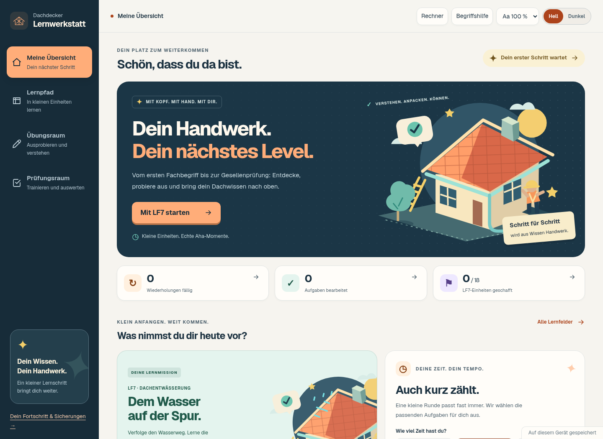
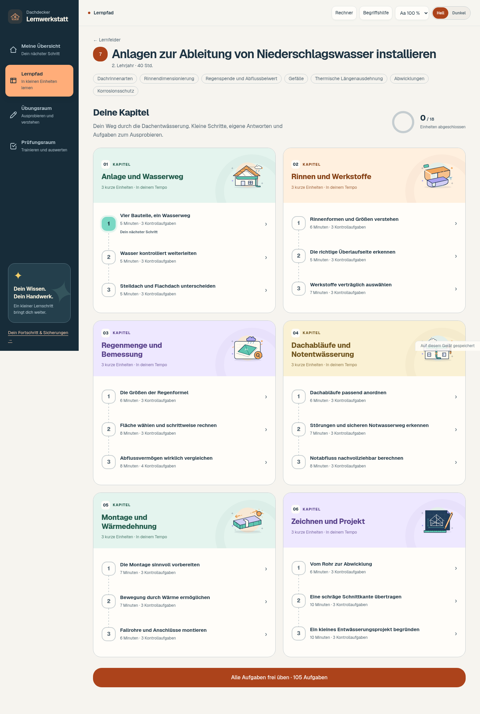

# Lernwerkstatt 0.3 – mehr Lust aufs Lernen

Die Übersicht hat eine eigene Dachbauszene, kräftige Orange-, Mint-, Violett- und Gelbtöne, eine dunkle Navigation und unterschiedlich gestaltete Lernkarten. Eigene SVG-Illustrationen liegen in der App und funktionieren offline.

Die Lernfelder zeigen Themenbilder und lassen sich nach Lehrjahr filtern. LF7 erscheint als zusammenhängender Einheitenpfad mit sechs bebilderten Kapitelköpfen. Jede abgeschlossene Einheit wird sichtbar; die Abschlussansicht würdigt den bearbeiteten Lernschritt, ohne daraus langfristige Beherrschung abzuleiten.

Der Übungsraum bietet sechs farbige Aktivitätskarten. Prüfungsstufen haben eigene Motive; die Auswertung zeigt die erreichten Punkte zusätzlich als Ring. Auch die laufenden Übungen besitzen einen gestalteten Kopf, eine klare Aufgabenfläche und ermutigende Rückmeldungen.

Lernwoche, Aufgabenstatistik und Einheitenfortschritt verwenden vorhandene echte Lernstände. Es gibt keine erfundenen XP, gekauften Erfolge oder zusätzlichen Zeitdruck. Kurze Einblendungen und Hover-Effekte respektieren die Einstellung für reduzierte Bewegung. Hell-/Dunkelmodus und Schriftvergrößerung bleiben erhalten.

Geprüft: 369 Funktionstests, TypeScript, ESLint ohne neue Warnungen, Produktionsbuild und statischer Mac-Export. Zusätzlich wurden die fünf Hauptansichten auf Desktop und Mobilgeräten, Schriftvergrößerung bis 130 %, Dunkelmodus sowie die bestehenden Speicher-/Prüfungs-/Fotoabläufe im Browser geprüft. Ein visueller Prüflauf ersetzt keine Erprobung mit Lernenden.
